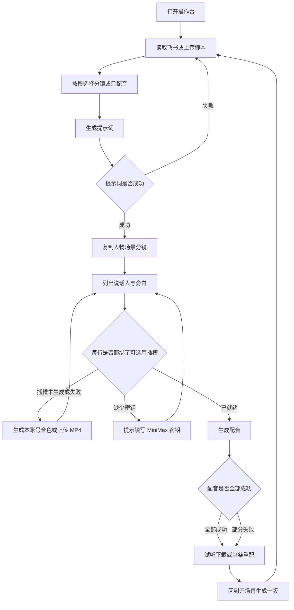
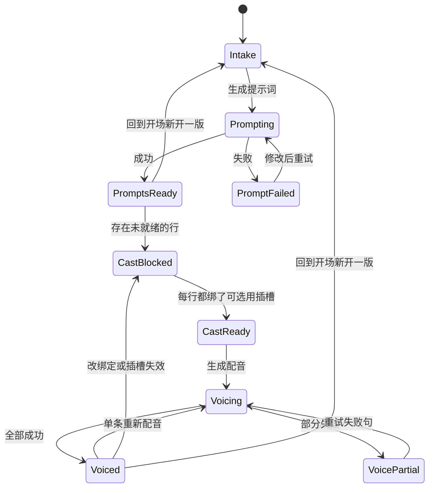
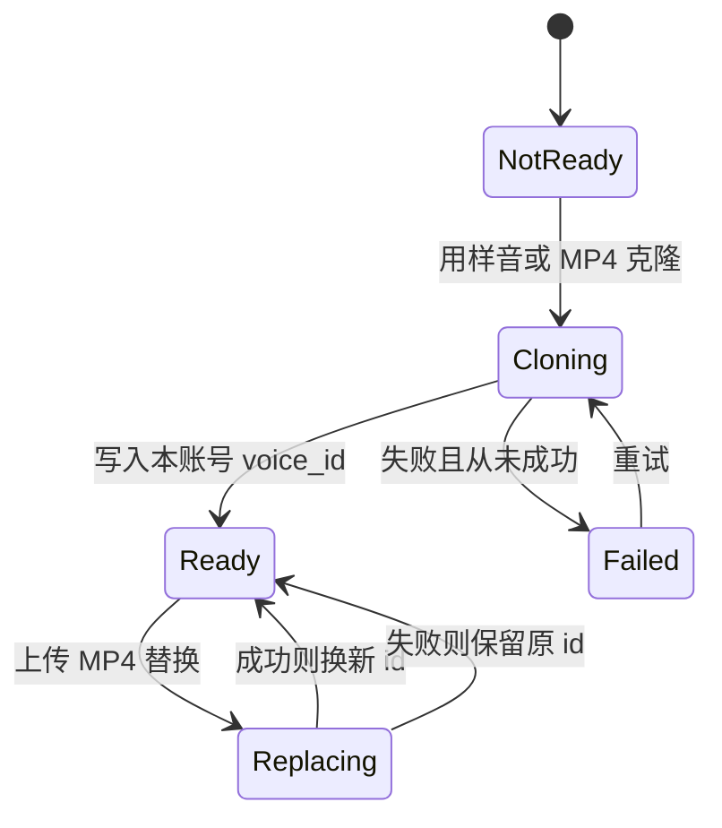

# PRD: 开场改为先提示词、再按角色确认音色

| 属性 | 内容 |
|------|------|
| 状态 | 工程：partial。见文末「工程验收状态」 |
| 范围 | 漫剧操作台开场：读脚本后只生成提示词；配音前按说话人与旁白绑定音色插槽；新 MiniMax 账号在本机克隆后才有可用 voice_id |
| 关联 | docs/workflows/libtv-studio.md、docs/workflows/episode-voiceover.md、docs/workflows/minimax-voice-clone-and-tts.md、docs/DESIGN.md、src/studio/static/index.html、src/studio/compile_episode.py |

## 背景与问题

操作台现在用一次「开始」做完两件事：按勾选生成人物三视图、场景和分镜提示词，并立刻为全稿口播合成 MP3。音色在编译脚本时写死。`SPEAKER_ALIAS` 只把「企业主 / 老板」和「招商顾问 / 招商主管」收成两个人，并分别指向 `assets/voices/ai-enterprise-owner` 与 `assets/voices/female-zhao-shang-lead`。脚本里出现别的称呼，会在提示词出来之前就报「无法识别说话人」。

这两套 `voice_id` 属于制作这份包时的 MiniMax 账号。安装包可以把 `voice.json` 带给同事，同事的新账号里并没有这两个音色。样音文件目前还在 `assets/**/*.mp3` 的忽略规则里，别人机器上往往连样音都没有。结果是：要把操作台交给同事用时，对方既走不完未知角色的剧本，也配不出声。

要分开的是两件独立的事。提示词只依赖脚本和 DeepSeek。配音依赖当前用户自己的 MiniMax 密钥，以及该密钥下真实存在的 `voice_id`。角色名单要等脚本解析完才知道，所以选声音发生在解析之后。

## 目标与非目标

### 目标

- 读入脚本并勾选「分镜演绎 / 只配音」之后，主操作只生成提示词。未绑定音色、未配置 MiniMax 时，提示词仍能复制。
- 提示词完成后，为本集每个说话人、以及存在旁白句时的旁白，各绑定一个音色插槽，再生成 MP3。
- 说话人保持脚本里的原名。不再要求先归并成「企业主」「招商顾问」。
- 安装包带两个默认音色插槽。一个插槽在任一时刻只有一个 `voice_id`。新账号必须先用样音或上传的 MP4 在本账号克隆，得到自己的 `voice_id` 之后，该插槽才可选用。
- 插槽可以替换，角色多于现有插槽时可以再增加。多行可以共用同一个插槽。本机克隆结果放在插件数据里，覆盖安装不清除。

### 非目标

- 公网访问、登录、页内嵌 LibTV、更换画风。
- 继续依赖兄弟仓「IP数字人项目」或飞书人物库才能克隆。
- 按性别、角色名或台词自动分配音色。
- 一个插槽同时保留多个 `voice_id`，或做音色市场、音色分享。
- 改写已生成提示词的画风规则、分镜字数上限和口播序号规则（仍是 `01`…`N`）。
- 把历史集里已经生成的 MP3 批量迁移到新绑定。

## 术语

| 术语 | 含义 |
|------|------|
| 提示词步 | 读脚本、勾选段落后，只生成人物、场景、分镜提示词 |
| 配音步 | 绑定完成后，按口播清单调用 MiniMax 合成 MP3 |
| 说话人 | 脚本对白里冒号前的称呼，按原文字保留 |
| 旁白 | 没有说话人的口播句；本集只要有一句，就单独占一行待绑定 |
| 音色插槽 | 一个可被角色选用的声音位。展示名 + 样音 + 至多一个本账号 `voice_id` |
| 默认插槽 | 随安装包提供的两枚插槽，对应现有 AI企业主、女招商主管 |
| 本账号 voice_id | 用当前 MiniMax 密钥克隆成功后写入插件数据的 id |
| 包内 voice_id | `voice.json` 里制作包时留下的 id。只说明制作账号曾经克隆过，不能拿去给别人的密钥做 TTS |
| 可选用 | 插槽已有本账号 `voice_id`，可以绑给角色并用于合成 |
| 场记单 | 提示词完成后的结果页：人物、场景、分镜、角色声音、配音 |

## 已拍板规则

| 规则 | 说明 |
|------|------|
| 先提示词，后配音 | 生成提示词不读取插槽，不调用 TTS。未全部绑定前不出现可用的「生成配音」 |
| 原名保留 | 解析出的每个不同说话人各占一行。旁白另占一行。没有旁白句时不出现旁白行 |
| 共用插槽 | 多行可以绑定同一插槽。绑定的是插槽，不是把 `voice_id` 抄进每一句后就与插槽脱钩 |
| 一槽一位 | 替换音色时，新 `voice_id` 覆盖旧值。插槽下不保留历史 id 列表 |
| 新账号不借用旧 id | 克隆完成前，配音与试探请求都不携带包内 `voice_id` |
| 默认两槽 | 安装后先看到 AI企业主、女招商主管两枚插槽，状态在没有本机记录时为「尚未在本账号生成」 |
| 克隆入口 | 用该插槽样音「生成本账号音色」，或上传 MP4 替换样音后再克隆。新增插槽同样走上传 MP4 |
| 样音限制 | 抽出的音轨短于 10 秒、长于 5 分钟，或文件大于 20MB，不发起克隆，并说明限制 |
| 密钥分开 | 缺 DeepSeek 密钥只挡住提示词步。缺 MiniMax 密钥仍可看提示词和绑定关系，克隆与配音说明需先在设置里填写密钥 |
| 单集互斥 | 同一时刻只跑一集，与现操作台一致 |
| 重跑不覆盖 | 同一脚本再生成提示词时新开产物目录。上一份场记单仍可从历史记录打开 |
| 历史条 | 已有产物、且没有本 PRD 绑定记录的集，试听和单条重配沿用该条已经写下的 `voice_id`，不强制补绑定 |

## 用户与角色

| 角色 | 目标 |
|------|------|
| 制作者（现有操作者） | 自己的剧本继续能出提示词和配音；两枚默认声音还能用，只是要先在本账号落到插槽上 |
| 同事（首次使用者） | 安装插件后，不依赖制作者电脑上的克隆音色；先拿到提示词，再为自己的 MiniMax 账号准备声音 |
| 后期 | 仍按场记单复制提示词，并按 `01`…`N` 取 MP3 |

## 功能域

### 1. 开场只生成提示词

第一屏仍是飞书链接或上传 `.md` / `.txt`，切段方式仍为程序切段或大模型切段，每一段仍选「分镜演绎」或「只配音」。主按钮文案改为「生成提示词」。成功后进入场记单，人物、场景、分镜的复制方式保持现有顺序。这一步失败时留在开场并说明原因，不创建配音清单请求。

出镜角色名、场景和分镜台词仍由程序从脚本确定。DeepSeek 只补外貌、场景和运镜。说话人不再经过两角色别名表。

### 2. 角色声音

场记单在分镜之后、配音列表之前增加「角色声音」。行的顺序按口播全文第一次出现。每行显示角色名（或「旁白」）、当前插槽、插槽状态。状态只用这四种：可选用、尚未在本账号生成、克隆中、失败。

每一行必须选中一枚「可选用」插槽后，本集才允许「生成配音」。选中尚未生成或失败的插槽时，按钮保持不可用，并指出哪一行还不能配。

### 3. 音色插槽

插槽存在于用户插件数据，不写回安装目录里的 `voice.json`。覆盖安装和卸载插件的现有数据策略不变：覆盖不删插件数据。

- 默认插槽两条，展示名分别为 AI企业主、女招商主管。包内要带可克隆的样音。样音随包分发，本账号 `voice_id` 不随包当作可用音色。
- 「生成本账号音色」用该插槽当前样音克隆。成功后状态变为可选用，并记下 `voice_id` 与所用模型。
- 「换成新声音」上传一个 MP4。抽出音轨，通过样音限制后，用新音轨克隆并替换该插槽的样音与 `voice_id`。
- 「新增插槽」要填写展示名并上传 MP4，成功后出现在所有集的可选列表里。展示名在本机插槽中不可重复。
- 克隆进行中，该插槽不可被选为可选用。从未成功过就停在失败，不写入 `voice_id`，并展示原因。已经可选用的插槽若替换失败，回到可选用并保留原来的 `voice_id`，同时展示这次失败原因。两种情况都可以重试。

### 4. 生成配音与单条重配

「生成配音」按本集口播顺序写出 MP3。每一句使用其说话人（或旁白）当前绑定插槽的本账号 `voice_id`。某一句失败时，其余已成功的文件保留，该句可单独重试。

已有的单条改字后「重新配音」保留，只替换该条文件，音色取这一句角色当时绑定的插槽。打开文件夹、单条下载、打包下载保持现有行为。

### 5. 页面

不新增设计令牌，不另起组件库。颜色、字体、按钮沿用 `src/studio/static/index.html` 的 `:root` 与 `docs/DESIGN.md`。开场需要让人看出当前停在「生成提示词」，场记单需要让人看出还要完成「角色声音」才能配音。

## 用户故事地图与版本切片

### 旅程主干

| 步骤 | 用户在做什么 | 起止 |
|------|----------------|------|
| 1. 读入 | 粘贴飞书链接或上传脚本，得到分段 | Entry：打开操作台 |
| 2. 勾选 | 每段选择分镜演绎或只配音 | |
| 3. 提示词 | 点「生成提示词」，等待人物、场景、分镜 | |
| 4. 复制 | 在场记单按顺序复制提示词，可先离开去做画面 | 提示词步 Exit：提示词可复制 |
| 5. 看角色 | 打开「角色声音」，看到说话人与旁白 | Entry：从场记单进入配音准备 |
| 6. 准备插槽 | 选用已就绪插槽，或克隆、替换、新增 | |
| 7. 绑定 | 每一行都指向一枚可选用插槽 | |
| 8. 配音 | 点「生成配音」，试听、改字、单条重配、下载 | Exit：本集 MP3 可交付；Teardown：回到开场重跑会新开目录，不删本集 |

逆向：提示词失败回到开场，不产生配音。克隆失败留在角色声音，不删除已有提示词。配音部分失败留在配音列表。用户可从场记单回到开场再生成一版新的提示词，旧目录仍在历史记录中。

### Release 0 故事

| 故事 | 验收要点 |
|------|----------|
| 作为制作者，我想先只生成提示词，以便同事还没有可用音色时也能拿走三视图和分镜 | 未填 MiniMax、且没有任何可选用插槽时，提示词仍生成并可复制；该次操作不发起 TTS |
| 作为制作者，我想按脚本原名得到说话人，以便称呼不在旧别名表里的剧本也能出提示词 | 一份含两名以上说话人、且称呼不是「企业主」「招商顾问」及其旧别名的脚本，能完成提示词步；场记单上的名字与脚本一致；不出现「无法识别说话人」 |
| 作为制作者，我想给每个说话人和旁白各绑一个插槽，以便角色声音分开 | 有旁白句时旁白单独成行；存在未绑定行、或绑定的插槽不是可选用时，「生成配音」不可用；全部就绪后才写出 MP3；两行可以选同一插槽 |
| 作为首次使用者，我想看到包里的两个默认插槽，以便知道可以从哪两个声音开始 | 安装后列表中有 AI企业主、女招商主管；没有本机 `voice_id` 时状态为「尚未在本账号生成」 |
| 作为新 MiniMax 账号的用户，我想用样音在本账号克隆，以便默认声音在我的密钥下真实存在 | 克隆完成前的请求不携带包内 `voice_id`；成功后该 id 记在插件数据；覆盖安装后仍在，且状态为可选用 |
| 作为用户，我想上传 MP4 替换或新增插槽，以便换成自己的声音 | 替换成功后该插槽只保留新的 `voice_id`；说话人数量多于两枚插槽时，可以新增一枚并完成绑定；音轨不满足 10 秒至 5 分钟、或文件大于 20MB 时不发起克隆并说明原因；MP4 没有音轨时同样不发起克隆 |
| 作为用户，我想在密钥缺失或克隆失败后继续留着提示词，以便不用从头再跑 | 缺 MiniMax 密钥时提示去设置填写，提示词仍在；克隆失败展示原因，已成功过的 `voice_id` 不被清掉；补齐条件后可重试 |
| 作为用户，我想改一句后只重配这一句，以便保留现在的单条修正 | 「重新配音」只替换该条 MP3，使用该角色当前绑定插槽的本账号 `voice_id` |

Release 0 可验收结果：用一份含两名以上、且不在旧别名表中的说话人的脚本，能先出提示词。新 MiniMax 账号在对应插槽克隆完成前不会被拿去请求包内旧 `voice_id`。每个说话人以及本集存在的旁白都绑到可选用插槽之后，才生成 MP3。

### Release 1

本期做：更换某插槽的 `voice_id` 之后，在当前这场记单上一键重配「本集里绑定该插槽」的全部分句。其他插槽已生成的 MP3 不动。历史集没有绑定记录的，不出现这个一键动作。

本期不做：跨历史集批量重配、自动侦测账号里已有音色、克隆进度的百分比。

| 故事 | 验收要点 |
|------|----------|
| 作为用户，我想在换了插槽声音后一键重配本集相关句子，以便不用逐条点击 | 只重配当前集、当前绑定该插槽的句子；其他句子的文件保持不变；其中某一句失败时，其余成功句保留，并可以再重试这一批 |

## 核心流程与状态机图

集的状态。回到开场再生成会新开一集目录，旧集留在历史记录，不从「已配音」退回清空。

插槽的状态。替换失败时，若该槽曾经可选用，恢复为可选用并保留原 `voice_id`，同时把这次显示为失败原因。从未成功过则停在失败，不写入 `voice_id`。

死胡同检查：`PromptFailed` 可以重试或换脚本。`CastBlocked` 可以去克隆或改绑定，也可以只复制提示词后离开。`Failed` 插槽可以重试。`VoicePartial` 可以重试失败句。没有必须配音才能离开的节点。

## 数据与 API 衔接

- 默认样音与展示名来自安装目录中的两枚音色资源。包内 `voice_id` 只作档案，不作为当前用户的合成参数。
- 插槽记录放在插件数据目录：展示名、样音位置、本账号 `voice_id`、模型、状态、最近一次失败原因。与 `docs/workflows/libtv-studio.md` 所述一致，装进 Dex Buddy 后数据在 `plugin-data/manju-studio/`，本机开发时数据在仓库目录。
- 本集绑定写在该集事实旁：每一行是说话人或旁白，指向插槽。合成当刻读取插槽上的本账号 `voice_id`。
- 提示词步继续使用现有 DeepSeek 调用。配音步继续使用现有 MiniMax 同步合成，密钥仍来自 Dex Buddy 设置或本机 `.env`。
- 克隆在本仓完成：样音上传、克隆、激活，直到得到 `voice_id`。不调用兄弟仓，不查飞书人物。
- MP4 只作为用户上传的容器。克隆使用其中抽出的音轨。抽出与临时文件放在可清空的 `temp/`，不写进安装目录。

实现时需要同步改写的文档（本 PRD 不直接改它们）：`docs/workflows/libtv-studio.md` 里「点开始同时出提示词和配音」、`docs/workflows/minimax-voice-clone-and-tts.md` 里「学新声仍在兄弟仓」、`docs/workflows/episode-voiceover.md` 里「本流不克隆」。

## 假设与待确认

| 项 | 处理 |
|----|------|
| 两个默认插槽的样音必须能随安装包分发 | 已定产品要求。现有 `assets/**/*.mp3` 被忽略，实现时要让这两份样音进入同事能安装到的包 |
| 同一账号对同一段样音再次克隆时返回新 id 还是已有 id | 以 MiniMax 当次返回为准。成功就写入插槽，不在客户端猜测复用 |
| 制作人自己的密钥其实已经拥有包内 id | 仍不直接拿包内 id 去合成。制作人与同事一样，对要用的插槽执行一次「生成本账号音色」 |
| 旁白与某个角色共用声音 | 允许，由用户把两行选到同一插槽 |
| 本集没有任何口播句 | 不出现角色声音表，也不要求生成配音；提示词步结果仍可复制 |
| 历史集 | 没有绑定记录则沿用该条已保存的 `voice_id`，见已拍板规则 |

无未关闭的产品分叉。工程实现细节（克隆请求字段、音轨抽出工具、插件数据文件名）在开发时按上述规则补齐，不改变用户可见步骤。

## 修订记录

| 日期 | 说明 |
|------|------|
| 2026-10-11 | 初稿。开场拆成提示词步与配音步；说话人原名保留；两枚默认插槽加本账号克隆；MP4 替换与新增插槽；Release 1 仅一键重配本集该插槽 |

## 1. 工程验收状态

> 由 `/team:prd-accept` 维护；勿手工编造「通过」。最后更新：2026-10-11T14:17:38Z，main@fb6b0c3，范围：R0,R1。本功能仍在工作区，fb6b0c3 不含这些改动。

### 总览

- 工程状态：`partial`
- 验收判定：Release 0 主路径已落地，有文案和缺测试的部分项；Release 1 未实现，且 PRD 写明本期要做
- 最近验收：2026-10-11T14:17:38Z
- 代码提交：`main@fb6b0c3`（功能未提交）
- 先出提示词、原名保留、绑定后才配音、本账号克隆与单条重配有单测
- 界面状态文案改成了「可用 / 还不能用 / 生成中」，角色行不再展示状态
- 换槽后一键重配本集相关句子没有入口

### Release 交付

| Release | 状态 | 说明 |
|---------|------|------|
| R0 | 部分 | 提示词与配音已拆开，克隆与绑定可用。状态文案、角色行展示、单句失败留档缺测试，页面改用 daisyUI |
| R1 | 未实现 | 更换插槽声音后，没有一键重配「本集绑定该插槽」的全部分句 |

### 功能验收清单（Agent 优先读此表）

| ID | 能力摘要 | Release | 状态 | 证据 |
|----|----------|---------|------|------|
| R0-1 | 未配音色也可生成并复制提示词，不发起 TTS | R0 | 通过 | `src/studio/jobs.py` 的 `run_pipeline` 只写提示词；`tests/test_voice_cast.py` 的 `test_prompt_step_does_not_call_tts` |
| R0-2 | 说话人按脚本原名，不报「无法识别说话人」 | R0 | 通过 | `src/studio/compile_episode.py` 不再用两角色别名表；`test_unknown_names_and_narration_stay` |
| R0-3 | 旁白成行；未绑或不可用时不能生成配音；可共用一槽 | R0 | 通过 | `voice_block_reason`、`bind_speaker`；`test_shared_slot_unblocks_voice`、`test_not_ready_slot_cannot_be_chosen` |
| R0-4 | 默认两槽，无本机 id 时状态为「尚未在本账号生成」 | R0 | 部分 | `seed_slots` 与 `test_defaults_are_not_ready` 覆盖未就绪。界面文案是「还不能用」；角色行只有名字和下拉框，状态在音色库卡片上 |
| R0-5 | 克隆不携带包内 voice_id，结果记在插件数据 | R0 | 通过 | `src/minimax_clone.py` 的 `build_clone_body`；`account_voice` 不用包内 id；`test_clone_body_omits_packaged_id`。路径随 `MANJU_DATA_ROOT` |
| R0-6 | 上传替换或新增，并拦住过短、过长、过大、无音轨 | R0 | 通过 | `add_slot`、`perform_clone`、`src/studio/audio_sample.py`；`test_limits_reject_before_clone`、`test_success_stores_only_the_new_id`。按钮文案是「添加音色」「换成新声音」 |
| R0-7 | 缺 MiniMax 密钥时提示词仍在；替换失败保留原 id | R0 | 通过 | `prepare_voice` 的密钥提示；`test_missing_key_does_not_clone`、`test_failed_replace_keeps_account_id` |
| R0-8 | 单条「重新配音」只用当前绑定的本账号 id | R0 | 通过 | `src/studio/jobs.py` 重配读取绑定插槽；`test_resynth_uses_bound_account_id` |
| R0-9 | 两份默认样音能随包装出去 | R0 | 通过 | `.gitignore` 对两份 `voice.mp3` 的否定规则；`dex-buddy-plugin.pack` 含 `assets/` |
| R0-10 | 没有绑定记录的历史集沿用已写下的 voice_id | R0 | 通过 | `test_history_keeps_written_voice_id` |
| R0-11 | 某一句失败时，已成功的 MP3 留下 | R0 | 部分 | `src/episode_voiceover.py` 的 `synthesize_manifest` 先写出文件和 `manifest-out.json`，再汇总抛错。`tests/` 没有这条用例 |
| R0-12 | 页面沿用原 `:root`，不另起组件库 | R0 | 部分 | 页面已用 daisyUI 5。色值留在 `[data-theme="studio"]`，见 `docs/DESIGN.md` |
| R0-13 | 本集没有口播时不要求配音 | R0 | 通过 | `src/studio/static/index.html`「这一集没有要配的句子」；无口播时不写 cast |
| R1-1 | 换槽后一键重配本集里绑定该槽的全部分句 | R1 | 未实现 | 只有单条「重新配音」。没有按插槽重配当前集其余句子、并保持其他插槽文件不动的动作 |

### 未完成与遗留

- Release 1：更换某插槽的 `voice_id` 后，一键重配当前场记单里绑定该插槽的全部分句。其他插槽的 MP3 不动。没有绑定记录的历史集不出现这个动作。某一句失败时，其余成功句保留，并可再重试这一批。
- 角色行按 PRD 应同时显示插槽状态。现在状态下放到音色库卡片，文案是「可用 / 还不能用 / 生成中 / 失败」。
- 单句合成失败后保留其余 MP3，有实现，没有单测。
- 按角色名默认对上 AI企业主、女招商主管已经实现（`_DEFAULT_MATCH`）。这在「非目标」里，不计入本次判定。
- 本功能还没有提交。`fb6b0c3` 只是当前 `HEAD`。

### 质量检查

| 检查项 | 状态 |
|--------|------|
| .venv/bin/python -m unittest discover -s tests -q | 通过，69 项 |
| （无） | 不适用 |
| 文档与 OpenAPI 同步 | 通过。`docs/workflows/libtv-studio.md`、`episode-voiceover.md`、`minimax-voice-clone-and-tts.md` 已改成音色库与本账号克隆。本仓无 OpenAPI |

---
统计：通过 10 / 部分 3 / 未实现 1 / 范围外 0
