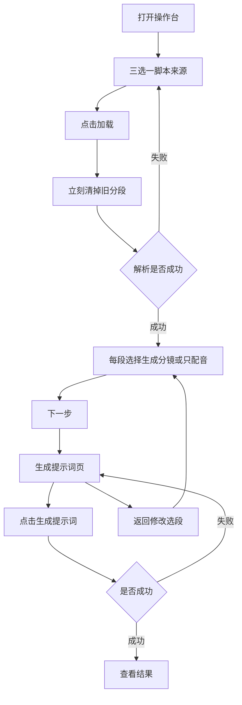
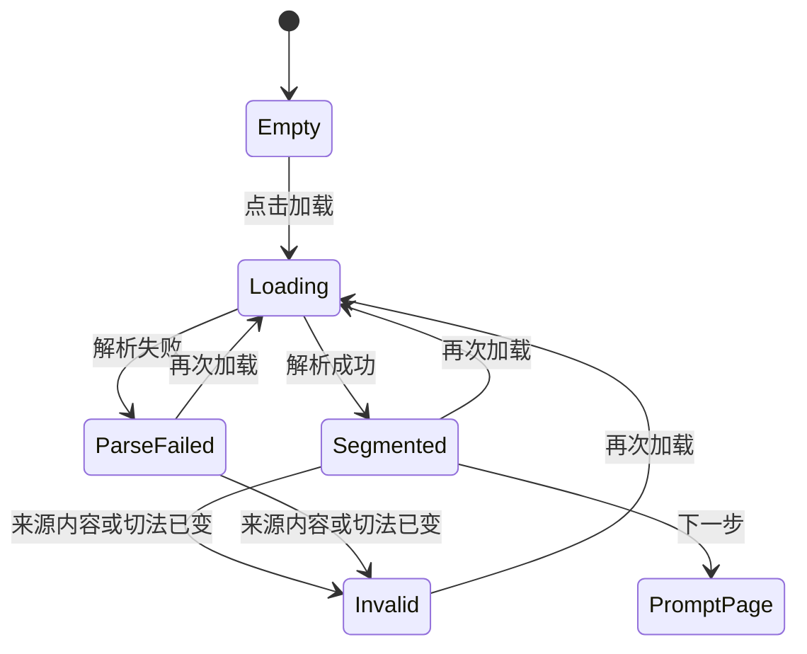
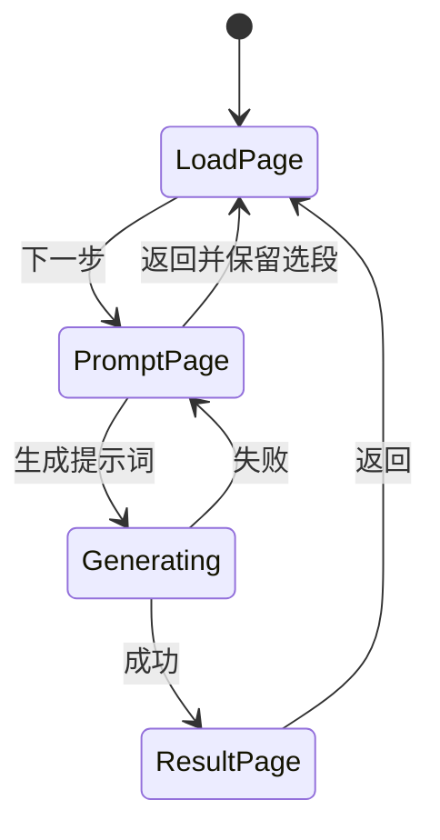

# PRD: 加载脚本与生成提示词分步

| 属性 | 内容 |
|------|------|
| 状态 | 工程：accepted。见文末「工程验收状态」 |
| 范围 | 漫剧操作台开场：第一页只加载脚本并选段；第二页才生成提示词 |
| 关联 | specs/prds/prd-00001-studio-voice-cast.md、docs/workflows/libtv-studio.md、docs/DESIGN.md、src/studio/static/index.html、src/studio/server.py |
| 替换 | prd-00001 里「第一屏同时加载并点生成提示词」的页面结构。先提示词、后配音，以及角色声音，仍以 prd-00001 为准 |

## 背景与问题

操作台步骤条是三步：加载脚本、生成提示词、查看结果。实现却把前两步画在同一个 `intake` 屏上。没有分段时，步骤条停在「加载脚本」，标题却是「生成提示词」，MiniMax 与配音的说明也出现在这一步。有了分段之后，步骤条又会因为列表非空而跳到「生成提示词」，页面并没有换。

「加载」只绑定飞书链接。没有合法链接时按钮禁用。上传 `.md` / `.txt` 会在选中文件时直接解析，不经过「加载」。分段方式改成「让模型分段」后再点加载，上传来的那段列表不会重跑，旧的「生成分镜 / 只配音」还留在下面。用户无法判断现在看到的是不是新切法的结果。

脚本来源在界面上叫「飞书文档」，上传控件挤在同一行。粘贴正文没有入口。服务端其实已经只接受一种来源：飞书链接、暂存文件，或页内脚本文本。

## 目标与非目标

### 目标

- 第一页只做加载脚本和选段。标题、说明和主按钮都不再写成「生成提示词」。
- 脚本有三种来源，一次只用一种：飞书链接、上传 `.md` / `.markdown` / `.txt`、页内粘贴正文。
- 分段方式仍是两种：默认按标题，或让模型分段。两种都作用在当前这一种来源上。
- 「加载」对三种来源是同一个动作。一点加载，旧分段立刻消失；成功后整表换成这次的结果；失败则列表保持空白，不把上一次分段补回来。
- 切换来源、改分段方式，或改动当前来源里的内容，也立刻清掉分段。列表要么对得上当前来源和当前切法，要么不显示。
- 有本次加载得到的分段时，第一页主按钮是「下一步」。第二页只读回顾每段的选择，主按钮才是「生成提示词」。成功后进入现有查看结果；失败留在第二页。

### 非目标

- 飞书多维表格、Word、PDF，以及其他二进制文档。
- 公网、登录、页内嵌 LibTV、更换画风。
- 改写按标题切开的规则、模型分段的提示词、人物场景分镜的生成规则、口播序号。
- 改角色声音、配音、历史记录的行为。历史记录仍直接打开查看结果，不重建当时的分段。
- 解析过程中自动跳到第二页，或进入第二页就自动开始生成。
- 本篇不设 Release 1。上面这些不做项不另开版本切片。

## 术语

| 术语 | 含义 |
|------|------|
| 脚本来源 | 飞书链接、上传文件、粘贴正文三者之一。提交时只带当前这一种 |
| 分段方式 | 「按标题分段」或「让模型分段」。决定怎么把正文切成段 |
| 选段 | 每一段上的「生成分镜」或「只配音」。不改变切段结果 |
| 分段列表 | 最近一次解析成功、且仍对得上当前来源与分段方式的那些段 |
| 作废 | 来源、来源内容或分段方式已变，列表必须立刻消失，下一步不可用 |
| 加载脚本页 | 步骤 1。读入、选择分段方式、加载、选段、下一步 |
| 生成提示词页 | 步骤 2。只读回顾选段，再点生成提示词 |
| 查看结果 | 步骤 3。现有场记单，本篇不改其内部 |

## 已拍板规则

| 规则 | 说明 |
|------|------|
| 一步一页 | 步骤条跟着页面走。加载脚本页恒为第 1 步，生成提示词页恒为第 2 步，查看结果恒为第 3 步。不再因为已经有分段或正在请求，就把第一页标成第二步 |
| 三种来源互斥 | 只显示当前来源的输入。切换来源时清掉另外两种的内容，并作废分段。请求里不同时带飞书链接、暂存路径和粘贴正文 |
| 飞书仍是文档链接 | 只接受整段就是 wiki 或 docx 链接的文本。不读多维表格，也不从一段说明里搜链接 |
| 上传不自动解析 | 选中或拖入 `.md` / `.markdown` / `.txt` 只暂存并记住文件名。解析只发生在点击「加载」 |
| 粘贴在页内 | 第三种来源是文本框，不另开弹窗。分段方式和「加载」始终看得见 |
| 先清空再出新表 | 点击「加载」的同一时刻去掉分段列表，再发解析请求。成功后用本次结果整表替换，每段的默认选段仍按现有规则：有「某人：台词」的段默认生成分镜，纯旁白默认只配音 |
| 失败不恢复 | 解析失败时列表保持空白，并显示原因。不还原清掉之前的那一版 |
| 一切换就作废 | 切换来源、修改当前链接 / 文件 / 正文，或改分段方式，立刻清掉列表和上一次解析错误。改某一段的「生成分镜 / 只配音」不作废 |
| 下一步看本次结果 | 只有列表对得上当前来源和当前分段方式时，「下一步」才可点。加载中不可点 |
| 第二页再生成 | 第二页不重新读飞书，也不重新切段。它使用最近一次解析返回的脚本正文，加上用户当时的选段。主按钮是「生成提示词」 |
| 生成失败留在第二页 | 失败时不进入查看结果，不创建配音请求。与 prd-00001 一致：这一步不调用 TTS |
| 返回保留选段 | 第二页「返回」回到第一页，保留刚才的脚本、来源和每一段的选择。查看结果里的「返回」也回到第一页；若这次会话里还留着那份分段，则保留，不自动进入第二页 |
| 生成进行中不可折返 | 生成提示词进行中，不提供返回，也不能再次点击生成。成功进入查看结果，失败停在第二页并说明原因 |
| 重跑不覆盖 | 同一脚本再次生成提示词仍新开产物目录。沿用 prd-00001 |
| 视觉不换库 | 不新增设计令牌，不另起组件库。控件用这一页已有的 daisyUI，见 docs/DESIGN.md |

## 用户与角色

| 角色 | 目标 |
|------|------|
| 制作者 | 先确认脚本切对了、每段的用途选对了，再生成提示词；切错时能看出旧列表已经作废 |
| 同事 | 用飞书链接、本地文本或粘贴正文都能走进同一条加载路径 |
| 后期 | 仍从查看结果按原顺序复制人物、场景和分镜。本篇不改变场记单 |

## 功能域

### 1. 加载脚本页

页面标题为「加载脚本」。说明只谈读入、分段和选段，并写明提示词在下一步生成。这一页不出现 MiniMax、配音或「提示词仍可复制」的提示，也不出现「生成提示词」按钮。

主按钮是「下一步」，靠右。没有对得上的分段列表时不可用。

### 2. 脚本区块

区块标题为「脚本」。来源用三选一，同一时刻只展开一种输入：

- 飞书链接：单行输入，占位提示粘贴 wiki 或 docx 链接。整段不是合法链接时，「加载」不可用。
- 上传文件：文件选择只接受 `.md`、`.markdown`、`.txt`。选定后显示文件名，可移除。移除或换文件都作废分段，且不立刻解析。拖入文件与此相同，并切到来源「上传文件」。
- 粘贴正文：多行文本框。去掉首尾空白后为空，则「加载」不可用。输入过程中不自动解析。

「分段」放在来源输入之外，加载前就能改。默认「按标题分段」，另一项「让模型分段」。

「加载」在当前来源没有可用内容时不可用。加载进行中，来源、分段方式和「加载」都不可操作，分段列表保持不显示。进行中的说明沿用现有区分：按标题时为正在加载脚本，让模型分段时为正在让模型分段。

### 3. 选段

解析成功后，在脚本区块下面列出每一段的标题和预览，右侧仍是「生成分镜」「只配音」。用户可改这些选择，改完不必重新加载。

按标题切不出段时，留在第一页，列表空白，并沿用现有提示：可以改用「让模型分段」。模型没能整理成分段、缺少 DeepSeek 密钥，或其他解析错误，同样留在第一页，列表空白，显示原因。

### 4. 生成提示词页

标题为「生成提示词」。说明改为：按上一步选好的段落，写出人物、场景和分镜；配音要等角色声音都选好。prd-00001 那条「这一步不配音。还没填 MiniMax 密钥，或声音还不能用时，提示词仍然可以复制。」移到这一页。

本页以只读方式列出每段标题和已选的「生成分镜」或「只配音」，不能在这里改选段。要改，点「返回」。

点「生成提示词」后的任务、产物目录、场记单标签和角色声音，都按现有实现与 prd-00001。成功则进入查看结果。历史记录仍可从顶栏打开；从历史打开某一次结果时，不要求还原加载页上的分段。

## 用户故事地图与版本切片

### 旅程主干

| 步骤 | 用户在做什么 | 起止 |
|------|----------------|------|
| 1. 打开 | 进入操作台，停在加载脚本 | Entry：打开操作台 |
| 2. 放入脚本 | 三选一：粘贴飞书链接、选定本地文本，或在文本框粘贴正文 | |
| 3. 加载 | 选好分段方式后点「加载」，等待本次分段替换旧列表 | |
| 4. 选段 | 为每段保留或改成生成分镜、只配音 | |
| 5. 下一步 | 进入生成提示词页，核对只读列表 | |
| 6. 生成 | 点「生成提示词」，等待人物、场景、分镜 | |
| 7. 查看 | 在查看结果里复制提示词，之后的角色声音与配音仍走 prd-00001 | Exit：提示词可复制。Teardown：返回第一页可改选段再生成一版，新开目录，不删已有结果 |

逆向：解析失败留在第一页，列表为空。切换来源、改来源内容或改分段方式会作废列表，必须重新加载才能再往下。生成失败留在第二页，不进入查看结果，不发起配音。第二页返回第一页时保留选段。查看结果返回第一页时，有会话内分段就保留，没有则是空白的加载页。

### Release 0 故事

| 故事 | 验收要点 |
|------|----------|
| 作为制作者，我想让第一页只表示加载脚本，以便不会以为已经在生成提示词 | 加载脚本页的标题是「加载脚本」；没有「生成提示词」按钮，也没有 MiniMax 或配音说明。已有分段时，步骤条仍停在第 1 步 |
| 作为制作者，我想用飞书链接、本地文本或粘贴正文之中的一种读入脚本，以便三种材料走同一条加载路径 | 同一时刻只显示一种输入。切换来源会清掉另外两种的内容。飞书来源不接受多维表格。上传只接受 `.md` / `.markdown` / `.txt`，选定或拖入后不自动出现分段。粘贴是页内文本框。当前来源没有可用内容时「加载」不可用 |
| 作为制作者，我想重新加载时先看到旧分段消失，再看到新结果，以便换了切法之后不会对着旧选择发呆 | 点击「加载」后，在响应返回之前分段列表已经不显示。成功后列表只含本次结果，默认选段规则与现在一致。失败时列表仍空白，并显示原因，上一次分段不会重新出现 |
| 作为制作者，我想一改来源或切法就作废当前分段，以便列表不会代表另一份脚本 | 切换来源、修改链接或正文、更换或移除文件、改分段方式之后，分段列表立即消失，上一次解析错误也消失，「下一步」不可用。只改某一段的「生成分镜 / 只配音」时，列表保留 |
| 作为制作者，我想选完段再进入第二页生成提示词，以便加载和生成是两步 | 没有对得上的分段时不能进入第二页。第二页标题是「生成提示词」，只读显示每段标题和选段，并带有 MiniMax 提示。点「生成提示词」才发起任务。成功进入查看结果。失败留在第二页，该次操作不发起 TTS，也不创建配音清单请求 |
| 作为制作者，我想从第二页返回修改选段，以便不必重新加载同一份脚本 | 「返回」回到第一页，脚本、来源和每一段的选择都还在。再次「下一步」后，第二页显示改过的选择。此返回不新开产物目录 |
| 作为制作者，我想生成过程中停在第二页，以便不会在半路回到加载页又开一次任务 | 生成进行中不能返回，也不能再次点击生成。成功后步骤条在「查看结果」。查看结果的「返回」回到第一页；会话里若还有分段则保留，且不自动打开第二页 |

Release 0 可验收结果：用飞书链接、上传文本、粘贴正文各走一遍，都能在第一页加载并选段，再在第二页点「生成提示词」后进入查看结果。把分段方式从按标题改成让模型分段，或再次点击加载时，旧的选段单选会先消失。解析失败或生成失败都不会带着旧分段或半成品配音进入下一步。

### Release 1

本篇不设 Release 1。

## 核心流程与状态机图

分段列表的状态。失效和解析失败在页面上都不显示旧单选。失效不是停留给用户确认的中间层，列表在进入该状态时已经清空。

页面状态。生成中只有成功或失败两个出口。

死胡同检查：`Empty` 与 `Invalid` 都可以再加载。`ParseFailed` 可以重试，也可以改来源或切法后进入 `Invalid` 再加载。`Segmented` 可以下一步、重新加载或被作废。`Generating` 不会停住：成功到查看结果，失败回第二页。查看结果可以返回第一页，也可以留下复制。没有必须生成成功才能离开的节点。

## 数据与 API 衔接

不新增接口。预览与创建任务仍走现有入口。

- 飞书链接继续用 `feishu_url`。上传继续先暂存，再在加载时用 `staged_path`。粘贴用已有的 `script_text`，不新开字段。
- 三者同时只提交一个，与 `src/studio/server.py` 的 `load_script` 一致。页内互斥之后，不应再靠「飞书链接和上传脚本只保留后选的一个」来替用户抉择。
- 分段方式继续用 `split_with`：`program` 为按标题，`model` 为让模型分段。切段仍由 `prepare_script` 完成。按标题的规则和模型提示词不在本篇改。
- 预览响应里的 `script_text` 是规范化后的正文。第二页提交生成时带上这份正文和每段的 `index`、`mode`、`title`、`start`，不再按链接重读飞书。
- 文件类型与大小限制保持不变：只接收 `.md` / `.markdown` / `.txt`，正文在 2MB 以内。
- 生成任务仍是同一时刻只跑一集。成功后的目录、场记单和配音清单请求与现在相同。

实现时需要同步改写的文档（本 PRD 不直接改它们）：`docs/workflows/libtv-studio.md` 里「飞书文档或上传后立刻分段，再在同一页点生成提示词」的日常步骤。`docs/doc_index.md` 已指向 PRD 索引，不必为这一篇再登记一行。

## 假设与待确认

| 项 | 处理 |
|----|------|
| 按标题与让模型分段的算法 | 已定沿用现状。本篇只改这些动作发生在哪一页、何时清空列表 |
| 粘贴很长的脚本 | 与上传共用 2MB 上限。超出时留在第一页说明，不进入第二页 |
| 模型分段缺少 DeepSeek 密钥 | 留在第一页，列表空白，并说明原因。不进入第二页 |
| 从历史记录打开的旧结果 | 不重建加载页的来源和选段。返回后是空白的加载脚本页，除非这次会话里本来就还有一份分段 |
| 查看结果内部的人物、场景、分镜、角色声音、配音 | 不改。边界仍是 prd-00001 |

无未关闭的产品分叉。工程实现细节（三选一控件用 tabs 还是 radio、加载中的进度条是否沿用现有流光）在开发时按已拍板规则补齐，不改变用户可见步骤。

## 修订记录

| 日期 | 说明 |
|------|------|
| 2026-10-12 | 初稿。开场拆成加载脚本页与生成提示词页；三种来源互斥；重新加载和切换来源或切法时先清掉分段 |

## 1. 工程验收状态

> 由 `/team:prd-accept` 维护；勿手工编造「通过」。最后更新：2026-10-12T02:47:04Z，main@e854da6，范围：R0,R1。本功能仍在工作区，e854da6 不含这些改动。

### 总览

- 工程状态：`accepted`
- 验收判定：Release 0 故事均已落地。本篇声明不设 Release 1，标为范围外
- 最近验收：2026-10-12T02:47:04Z
- 代码提交：`main@e854da6`（功能未提交）
- 开场拆成加载脚本页与生成提示词页。步骤条跟着页面走，不再因已有分段跳步
- 飞书链接、上传文本、粘贴正文互斥，点「加载」才切段；改来源或切法会先清掉列表
- 生成失败留在第二页，这一步不调用 TTS。第二页和查看结果的「返回」都保留会话内分段

### Release 交付

| Release | 状态 | 说明 |
|---------|------|------|
| R0 | 通过 | 加载与生成分成两页。三种来源、先清空再出表、失败不恢复、返回保留选段均在页面脚本里 |
| R1 | 范围外 | 本篇写明不设 Release 1 |

### 功能验收清单（Agent 优先读此表）

| ID | 能力摘要 | Release | 状态 | 证据 |
|----|----------|---------|------|------|
| R0-1 | 第一页标题是「加载脚本」，已有分段时步骤条仍在第 1 步 | R0 | 通过 | `src/studio/static/index.html` 的 intake 标题与 `stepOn`；`tests/test_studio.py` 断言该模板没有「生成提示词」和 MiniMax |
| R0-2 | 三种来源互斥，上传不自动解析，空内容不能加载 | R0 | 通过 | 来源 radio 与 `x-if`；`takeFile` 只暂存；`canLoad`；飞书正则只认 wiki/docx。服务端仍是 `load_script` |
| R0-3 | 点「加载」先清列表；失败保持空白并显示原因 | R0 | 通过 | `loadScript` 在请求前清空 `sections`，失败分支不写回旧列表。按标题切不出段仍抛出现有「可以改用大模型整理」 |
| R0-4 | 改来源、内容或切法立即作废；只改选段保留列表 | R0 | 通过 | `applySource`、`invalidate`、分段下拉的 `@change`。选段 radio 只改 `sec.mode` |
| R0-5 | 第二页只读回顾后再生成；失败留在第二页且不发起 TTS | R0 | 通过 | prompt 模板无选段 radio，按钮才调用 `start`。请求体只有 `script_text` 与分段字段。`poll` 在 `error` 时不改 `screen`。`run_pipeline` 不调用 `synthesize_voice` |
| R0-6 | 第二页「返回」保留来源和选段，不新开目录 | R0 | 通过 | `backToLoad` 只切回 `intake`，不清 `sections` |
| R0-7 | 生成中不能返回或再点生成；查看结果返回不自动打开第二页 | R0 | 通过 | 返回按钮 `x-show="!busy"`，生成按钮 `:disabled="busy"`。查看结果返回是 `screen = 'intake'`。`newScript` 在生成中直接返回 |
| R1-1 | 本篇不设 Release 1 | R1 | 范围外 | PRD「Release 1」节写明不另开版本切片 |

### 未完成与遗留

- 无阻塞项。
- 功能还没有提交。`e854da6` 只是当前 `HEAD`。
- 左上角「AI漫剧大师」可清掉当前脚本并回到空白加载页。这是验收范围外的补充，「返回」仍保留分段。

### 质量检查

| 检查项 | 状态 |
|--------|------|
| .venv/bin/python -m unittest discover -s tests -q | 通过，70 项 |
| （无） | 不适用 |
| 文档与 OpenAPI 同步 | 通过。`docs/workflows/libtv-studio.md` 日常步骤已改成先加载再进入第二页生成。`docs/doc_index.md` 摘要已同步。本仓无 OpenAPI |

---
统计：通过 7 / 部分 0 / 未实现 0 / 范围外 1
