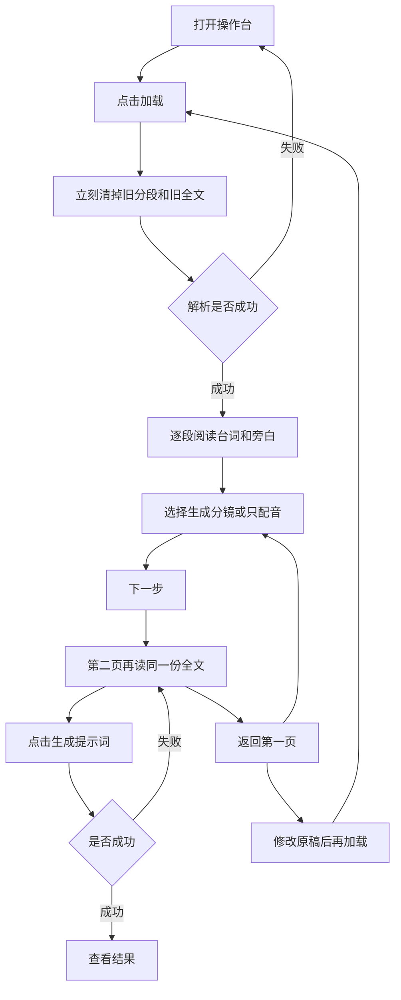
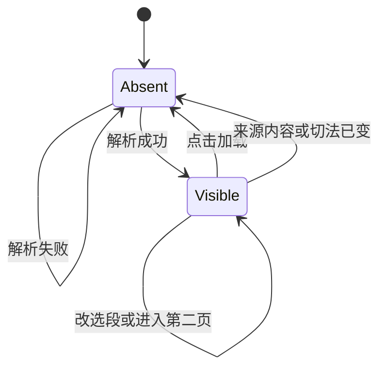

# PRD: 分段口播全文确认

| 属性 | 内容 |
|------|------|
| 状态 | 工程：accepted。见文末「工程验收状态」 |
| 范围 | 漫剧操作台第一页「加载脚本」与第二页「生成提示词」：分段列表里完整展示每段口播 |
| 关联 | specs/prds/prd-00002-script-intake.md、specs/prds/prd-00001-studio-voice-cast.md、docs/workflows/libtv-studio.md、docs/DESIGN.md、src/studio/static/index.html、src/studio/server.py、src/studio/compile_episode.py |
| 不改 | 切段规则、默认选段、提示词生成、角色声音、查看结果。作废、返回和生成失败仍以 prd-00002 为准 |

## 背景与问题

prd-00002 把开场拆成先加载并选段，再进入下一页生成提示词。分段之后，制作者只能看到段标题，外加第一句最多 42 字的预览。第二页连这句预览也没有，只剩标题和「生成分镜 / 只配音」。

解析其实已经把每段拆成逐句。有「某人：台词」的记为对白，没有称呼的口播记为旁白。这些句子停在服务端，预览响应没有带出来。

这一步是确认脚本。制作者要先看清每段里谁说了什么、旁白是什么，认为正确才进入下一步。现在看不见全文，无法判断切段和说话人是否可用。

## 目标与非目标

### 目标

- 解析成功后，第一页和第二页都按该段正文顺序，完整展开每一句口播。
- 对白显示解析出的人名和全文。没有人名的句子显示「旁白」和全文。
- 句子不截断、不折叠。长句在页面里换行，长段随页面滚动看完。
- 空段仍列出标题，并写明「这一段没有口播」。
- 两页都只读这些句子。标错时回到原稿修改，再重新加载。
- 第一页仍可改「生成分镜 / 只配音」。改选段不清列表，也不改句子。
- 第二页不能改选段，也不能改句。看对了再点「生成提示词」。要改选段或原稿，点「返回」。

### 非目标

- 在页面上改说话人、把对白改成旁白，或修改台词文字。
- 新开一步专门做确认。确认就发生在现有的第一页和第二页。
- 折叠摘要、只展开当前段、或用「解析可能有误」之类的置信提示代替全文。
- 改按标题切开的规则、模型分段的提示词、默认选段规则。
- 把第一段标题之前的角色说明、选题，或配图，放进列表。
- 改查看结果里的人物、场景、分镜、角色声音和配音。历史记录仍直接打开查看结果，不重建当时的分段。
- 本篇不设 Release 1。上面这些不做项不另开版本切片。

## 术语

| 术语 | 含义 |
|------|------|
| 口播 | 一段正文里留下来的一句对白或旁白。配图、空行和标题不算 |
| 对白 | 能解析出人名的句子。页面显示该人名 |
| 旁白 | 没有人名的口播。页面固定显示「旁白」 |
| 段内全文 | 某一段的全部口播，按正文顺序排开，不截断 |
| 空段 | 标题在，但没有任何口播 |
| 选段 | 每一段上的「生成分镜」或「只配音」。不改变口播文字 |

## 已拍板规则

| 规则 | 说明 |
|------|------|
| 两页都展开 | 第一页用来选段时就能核对全文。第二页是生成前的最后确认。不增加步骤，步骤条仍是加载脚本、生成提示词、查看结果 |
| 一句一行 | 每句单独成行。顺序与该段正文一致。全文换行，不截成 42 字，也不收进折叠 |
| 人名或旁白 | 对白用解析出的原名。没有人名就写「旁白」。同一段里对白和旁白交错时，按原顺序都显示 |
| 空段要说清 | 没有口播的段仍出现在列表里，标题下写「这一段没有口播」，避免被看成加载失败 |
| 只读 | 两页都不能改人名、旁白标记或台词。标错了就改原稿，再点「加载」 |
| 选段不改句子 | 第一页改「生成分镜 / 只配音」时，段内全文保持不动，列表不作废 |
| 第二页不能改选段 | 沿用 prd-00002。要改选段，返回第一页。要改句子，返回后改原稿再加载 |
| 作废规则不动 | 切换来源、修改当前来源内容，或改分段方式，列表立刻消失。点「加载」时也先清掉旧列表 |
| 生成规则不动 | 第二页仍用最近一次解析得到的正文和当时的选段去生成。失败留在第二页，不进入查看结果，不配音 |
| 视觉不换库 | 不新增设计令牌，不另起组件库。控件用这一页已有的 daisyUI，见 docs/DESIGN.md |

## 用户与角色

| 角色 | 目标 |
|------|------|
| 制作者 | 分段后看清每段的人物台词和旁白，确认脚本无误再选段、再生成提示词 |
| 同事 | 飞书链接、上传文本、粘贴正文三种来源看到同一套全文，不因来源不同而少句子 |
| 后期 | 仍从查看结果复制人物、场景和分镜。本篇不改变场记单 |

## 功能域

### 1. 第一页的段内全文

解析成功后，每一段先显示标题，标题下按顺序列出全部口播。对白行是人名加全文，旁白行是「旁白」加全文。空段在标题下只显示「这一段没有口播」。

右侧仍是「生成分镜」「只配音」。用户可改这些选择。改完不必重新加载，句子也不变。

原来那行最多 42 字的预览不再作为确认内容。页面以段内全文为准。

按标题切不出段、模型没能整理成分段，或其他解析错误时，仍留在第一页，列表空白，并显示原因。没有列表时不显示口播。

### 2. 第二页的段内全文

标题、说明和 MiniMax 提示沿用 prd-00002，不在本篇改写。

本页列出与第一页相同的段内全文，右侧只读显示已选的「生成分镜」或「只配音」。不能在这里改选段，也不能改句。

看对了，点「生成提示词」。要改选段或原稿，点「返回」。返回后第一页仍保留刚才的脚本、来源、选段和同一份全文。

生成进行中，全文仍可阅读。沿用 prd-00002：此时不能返回，也不能再次点击生成。成功进入查看结果。失败留在第二页，全文还在，便于对照错误原因。

### 3. 标错之后

说话人标错、旁白被当成对白，或句子内容不对时，本页不提供改句。制作者返回第一页，修改飞书文档、上传文件或粘贴正文，再点「加载」。加载一开始旧全文消失；成功后整表换成新结果。

只改某一段的「生成分镜 / 只配音」不会触发这次重载。

## 用户故事地图与版本切片

### 旅程主干

| 步骤 | 用户在做什么 | 起止 |
|------|----------------|------|
| 1. 打开 | 进入操作台，停在加载脚本 | Entry：打开操作台 |
| 2. 放入脚本 | 三选一：飞书链接、上传文本，或粘贴正文 | |
| 3. 加载 | 选好分段方式后点「加载」，等待本次分段替换旧列表 | |
| 4. 核对全文 | 逐段阅读人物台词和旁白，确认切段与说话人 | |
| 5. 选段 | 为每段保留或改成生成分镜、只配音。句子不变 | |
| 6. 下一步 | 进入生成提示词页，再读一遍同一份全文和已选用途 | |
| 7. 生成 | 确认无误后点「生成提示词」 | |
| 8. 查看 | 在查看结果里复制提示词。之后的角色声音与配音仍走 prd-00001 | Exit：提示词可复制。Teardown：返回第一页可改选段或改原稿再加载；新生成仍新开目录 |

逆向：全文不对时不进入生成。返回第一页改原稿再加载，旧句子不会留在列表里。只想改选段时，返回后改单选再进第二页，句子与改前相同。解析失败、来源或切法变化、生成失败的出口仍按 prd-00002：失败不带着旧列表或半成品配音进入下一步。

### Release 0 故事

| 故事 | 验收要点 |
|------|----------|
| 作为制作者，我想在加载完成后看到每段的全部人物台词和旁白，以便确认这是不是要制作的脚本 | 用一份同时含对白段和纯旁白段的脚本加载后，第一页每段按正文顺序列出全部句子。对白显示原名，无名字的句子显示「旁白」。长句完整换行，不被截成 42 字，也不能折叠后才看见 |
| 作为制作者，我想在生成前提词页再看一遍同一份全文，以便正确了才点生成 | 第二页显示与第一页相同的句子和说话人，并只读带上已选的「生成分镜」或「只配音」。这里没有改句控件，也没有改选段的单选。点「生成提示词」后的任务仍按 prd-00002 |
| 作为制作者，我想空段被明确说出来，以便不会把它当成没加载完 | 标题下没有口播的段仍出现在两页列表中，并显示「这一段没有口播」 |
| 作为制作者，我想改选段时句子保持不动，以便用途选择和脚本文字是两件事 | 第一页把某一段从「生成分镜」改成「只配音」，或改回去，段内全文一字不变，列表不消失。再次进入第二页时，全文仍是这些句子，用途显示为改后的选择 |
| 作为制作者，我想标错时回去改原稿，以便页面不会变成另一份没被加载的脚本 | 两页都不能编辑人名、旁白或台词。返回第一页后修改来源内容并再次加载：点击加载时旧全文消失，成功后只显示新句子。只改选段不会换句子 |
| 作为制作者，我想一改来源或切法就不再看见旧全文，以便不会确认到另一份脚本 | 切换来源、修改链接或正文、更换或移除文件、改分段方式之后，分段列表和其中的口播立即消失，「下一步」不可用。解析失败时列表保持空白 |

Release 0 可验收结果：一份脚本里至少有一段对白、一段纯旁白、一段没有口播。加载后两页都能看完全部句子和说话人。把长句与现在最多 42 字的预览对比，页面上的是全文。改选段不改句子。第二页不能编辑。改原稿再加载后，列表换成新句子。来源或切法一变，列表立刻消失。

### Release 1

本篇不设 Release 1。

## 核心流程与状态机图

段内全文没有单独的编辑态。它跟着分段列表出现和消失。改选段或进入第二页都不产生另一份句子。

死胡同检查：`Absent` 可以再次加载。`Visible` 可以下一步、返回、改选段，或因改原稿、改来源、改切法而清空。没有「必须在页面上改句才能离开」的节点。生成中的折返限制仍按 prd-00002，失败会回到仍显示全文的第二页。

## 数据与 API 衔接

不新增接口。预览与创建任务仍走现有入口。切段仍由 `prepare_script` 完成，按标题和让模型分段的规则不在本篇改。

- 预览响应的每个分段增加 `lines`。每一项是 `speaker` 和 `text`。`text` 是该句全文。对白的 `speaker` 是解析出的原名；没有人名时，`speaker` 在交给页面之前就是「旁白」。
- `lines` 的顺序与该段正文里留下的口播顺序一致。空段的 `lines` 为空数组，页面据此显示「这一段没有口播」。
- 现有的 `index`、`title`、`mode`、`start` 和响应里的 `script_text` 保留。第二页提交生成时仍带这份正文和每段的 `index`、`mode`、`title`、`start`。`lines` 只用于展示，不作为用户可改后回传的脚本。
- 现有 `preview` 字段可以留下，但两页都不再用它充当确认内容。确认只看 `lines`。
- 句子从哪几行来，仍用 `src/studio/compile_episode.py` 里已有的段内条目：对白和旁白的区分不改。人名后的情绪括注若今天没有进入说话人或台词，本篇也不补进页面。
- 文件类型、2MB 上限、三种来源互斥、`split_with` 的取值，都沿用 prd-00002。

实现时需要同步改写的文档（本 PRD 不直接改它们）：`docs/workflows/libtv-studio.md` 里加载后只看标题和选段的那几步。`docs/doc_index.md` 已指向 PRD 索引，不必为这一篇再登记一行。

## 假设与待确认

| 项 | 处理 |
|----|------|
| 说话人解析规则 | 已定沿用现状。有「某人：台词」的是对白，其余留下的正文是旁白 |
| 情绪括注 | 已定不在本篇显示。页面只显示今天已经解析出的人名和台词 |
| 空段仍可进入下一步 | 已定。空段只提示「这一段没有口播」，不新增一道拦截。若用户把它选成「生成分镜」而后生成失败，仍留在第二页，规则见 prd-00002 |
| 很长的一段 | 已定全部展开，随页面滚动。不做段内分页或折叠 |
| 从历史记录打开的旧结果 | 不重建加载页的全文。返回后是否还有分段，仍按 prd-00002 的会话规则 |
| 查看结果内部 | 不改。边界仍是 prd-00001 |

无未关闭的产品分叉。人名与「旁白」的字号、左右排布在开发时按现有 daisyUI 补齐，不改变谁被显示、显示全文还是摘要。

## 修订记录

| 日期 | 说明 |
|------|------|
| 2026-10-13 | 初稿。两页按原文顺序完整展示人物台词和旁白；只读确认后再继续；标错则改原稿再加载 |

## 1. 工程验收状态

> 由 `/team:prd-accept` 维护；勿手工编造「通过」。最后更新：2026-10-13T03:53:35Z，main@fd42b99，范围：R0,R1。本功能仍在工作区，fd42b99 不含这些改动。

### 总览

- 工程状态：`accepted`
- 验收判定：Release 0 故事均已落地。本篇声明不设 Release 1，标为范围外
- 最近验收：2026-10-13T03:53:35Z
- 代码提交：`main@fd42b99`（功能未提交）
- 预览响应每段带只读 `lines`。对白用原名，没有人名的句子在交给页面前写成「旁白」，空段是空数组
- 第一页和第二页按原文顺序列出全文，长句换行，不再用 42 字预览做确认。空段写「这一段没有口播」
- 改选段只改 `mode`。第二页没有改句或改选段控件，生成请求不回传 `lines`

### Release 交付

| Release | 状态 | 说明 |
|---------|------|------|
| R0 | 通过 | 两页只读展示段内全文。改选段不改句子，改来源或切法仍立刻清列表 |
| R1 | 范围外 | 本篇写明不设 Release 1 |

### 功能验收清单（Agent 优先读此表）

| ID | 能力摘要 | Release | 状态 | 证据 |
|----|----------|---------|------|------|
| R0-1 | 第一页按顺序展示每段全部对白和旁白，长句不截断、不折叠 | R0 | 通过 | `section_lines` 用全文和 `display_speaker`。第一页列表 `x-text="line.text"`，`break-words`，无 `line-clamp`。`test_preview_lines_keep_full_spoken_text` |
| R0-2 | 第二页同一份全文，用途只读，不能改句或改选段 | R0 | 通过 | 第二页同一 `sec.lines`，用途是文本不是单选。`start()` 只提交 `index`、`mode`、`title`、`start` |
| R0-3 | 空段两页都写明「这一段没有口播」 | R0 | 通过 | 两页在 `lines` 为空时显示该句。测试断言空段 `lines == []` |
| R0-4 | 改选段不改句子，列表不消失 | R0 | 通过 | 第一页单选只绑定 `sec.mode`。第二页按改后的 `mode` 显示「生成分镜」或「只配音」 |
| R0-5 | 两页不能改句；再加载时旧全文先消失，成功后换成新句子 | R0 | 通过 | 加载页和生成页的口播没有输入框。查看结果里的配音改字不在本篇。`loadScript` 请求前清空 `sections`，成功后整表替换 |
| R0-6 | 改来源或切法后列表和口播立即消失，解析失败保持空白 | R0 | 通过 | `invalidate`、`applySource`、正文 `@input`、分段 `@change`、`clearFile`。`loadScript` 的失败分支不写回旧列表 |
| R1-1 | 本篇不设 Release 1 | R1 | 范围外 | PRD「Release 1」节写明不另开版本切片 |

### 未完成与遗留

- 无阻塞项。
- 功能还没有提交。`fd42b99` 只是当前 `HEAD`。

### 质量检查

| 检查项 | 状态 |
|--------|------|
| .venv/bin/python -m unittest discover -s tests -q | 通过，71 项 |
| （无） | 不适用 |
| 文档与 OpenAPI 同步 | 通过。`docs/workflows/libtv-studio.md` 第 3、4 步已写成两页核对段内全文。`docs/doc_index.md` 摘要已同步。本仓无 OpenAPI |

---
统计：通过 6 / 部分 0 / 未实现 0 / 范围外 1
