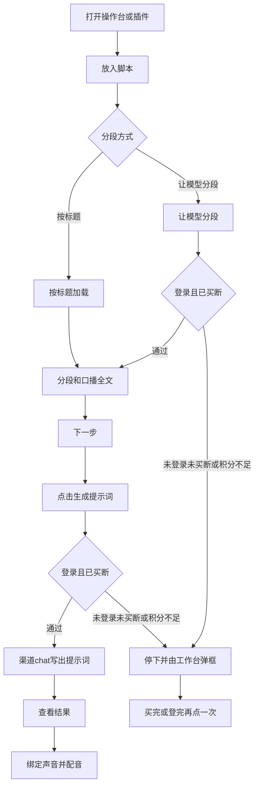
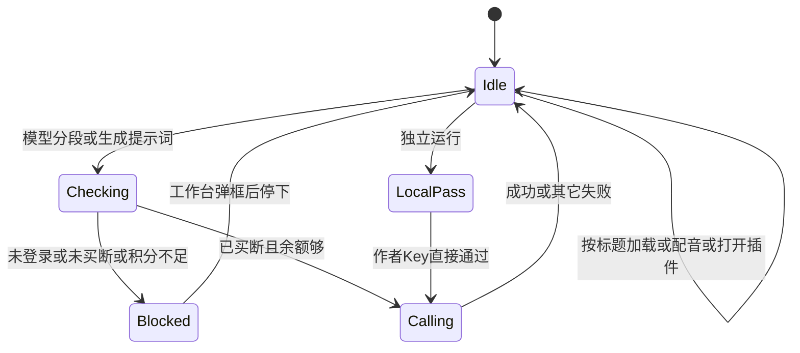

# PRD: 对话改走 Dex Buddy 并校验买断

| 属性 | 内容 |
|------|------|
| 状态 | 工程：accepted。见文末「工程验收状态」 |
| 范围 | 命令行、浏览器操作台、Dex Buddy 插件三条入口的对话调用；插件设置页的提示词密钥组；生成前的买断校验 |
| 关联 | specs/prds/prd-00002-script-intake.md、specs/prds/prd-00001-studio-voice-cast.md、docs/workflows/libtv-studio.md、docs/workflows/script-to-libtv-prompts.md、plugin.manifest.json、index.js、src/deepseek_client.py、src/script_preprocess.py、src/studio/compile_episode.py、src/generate_episode.py |
| 依据 | HyHarness `docs/plugin-development/`（models.md、runtime.md、manifest.md、distribute.md），SDK 母版 `1.0.0` |
| 不改 | 加载脚本页与生成提示词页的步骤、段内全文确认、角色声音、MiniMax 配音、飞书读取。清单 id 仍是 `manju-studio` |

## 背景与问题

提示词生成和「让模型分段」今天打 DeepSeek。插件设置页向同事要 `DEEPSEEK_API_KEY`、模型和接口地址。装进 Dex Buddy 之后，对话仍记在作者或同事自己的 DeepSeek 账上，而不是使用者登录的 Dex Buddy 账号。

最新插件开发文档要求：插件不要自己请求供应商网关；文案走拷进 `lib/` 的 SDK；开发用作者 Key，上线扣使用者积分；会烧模型的步骤先 `requireEntitlement`，失败由工作台弹登录、购买或积分不够，插件页面不自己画这些文案。

不换这条链路，插件无法按新文档上架：同事仍要申请 DeepSeek，买断也无法卡在真正调用对话的那两步。

## 目标与非目标

### 目标

- 命令行、浏览器操作台、插件三条入口都不再调用 DeepSeek。对话走 Dex Buddy 渠道 chat。
- 模型 id 来自 `list()` 里 `kind=chat` 的渠道 Model ID；目录为空时回退 `dexbuddy-chat`。使用者不再填写模型名或接口地址。
- 工作台里，只有「让模型分段」和「生成提示词」会先校验买断。按标题加载、配音、历史、打开文件夹不校验。打开插件不自动校验。
- 未登录、未买断、积分不够时，这次生成停住。页面不出现购买、登录或充值文案。买完或登完后，由使用者再点一次。
- 插件设置只保留飞书和 MiniMax。不向使用者收集 `DEX_BUDDY_API_KEY`。
- 独立运行用本机 `.env` 的 `DEX_BUDDY_API_KEY`（`dbh_sk_` 开头）。同一条调用直接通过买断，不弹购买框。
- 安装包带上 `lib/` 里的 Node 与 Python SDK，版本与文档母版 `1.0.0` 一致。

### 非目标

- 接入生图（`images.generate`）。
- 生成前的报价确认页，或把报价金额画在操作台上。
- 设置里自选模型、自填渠道 Model ID 或网关地址。
- 打开插件时自动校验买断或登录。
- 改清单 id 为 `app-dexbuddy-` 前缀。已购记录继续对 `manju-studio`。
- 在本仓添加调用 Dex Buddy 的 GitHub 工作流。
- 保留 DeepSeek 双栈，或让命令行继续走 DeepSeek、插件走 Dex Buddy。
- 自绘购买、登录或充值提示，或把错误码贴到页面上充当购买引导。
- 把飞书读取或 MiniMax 配音改成 Dex Buddy 网关能力。
- 本篇不设 Release 1。上面这些不做项不另开版本切片。

## 术语

| 术语 | 含义 |
|------|------|
| 渠道 Model ID | `list()` 返回的 `data[].id`。按 `kind` 选用。chat 空目录时回退 `dexbuddy-chat` |
| 买断校验 | Node 侧 `requireEntitlement(ctx)`。无参，不传 `pluginId`。不看积分 |
| 烧模型步骤 | 会真正调用对话补全的动作：加载时 `split_with=model`，以及「生成提示词」 |
| 宿主弹框 | 工作台对 `UNAUTHORIZED`、`NOT_ENTITLED`、`INSUFFICIENT_CREDITS` 自行弹出的登录、购买、积分不够 |
| 独立运行 | 命令行脚本，以及本机 `scripts/run_studio.py` 打开的浏览器操作台。不经过 Dex Buddy 工作台 |
| 使用者账号 | 装进 Dex Buddy 后登录的那个人。对话积分记在他头上 |
| 作者 Key | 本机环境变量 `DEX_BUDDY_API_KEY`。只给独立运行。不进设置页，不进 zip |

## 已拍板规则

| 规则 | 说明 |
|------|------|
| 全入口换对话 | 命令行、浏览器操作台、插件都走 Dex Buddy chat。仓库不再要求 `DEEPSEEK_API_KEY`、`DEEPSEEK_BASE_URL`、`DEEPSEEK_MODEL` |
| 清单 id 不动 | `plugin.manifest.json` 的 `id` 仍是 `manju-studio`。宿主用这个值盖 `X-Plugin-Id` |
| 设置不再要 DeepSeek | 去掉「提示词」组里的三项。飞书 App ID / App Secret 与 MiniMax 密钥保留 |
| 不向使用者要网关 Key | `DEX_BUDDY_API_KEY` 不进 `configSchema`，不进 zip。独立运行写在本机 `.env` |
| 模型由目录决定 | 先 `list()`，再按 `kind=chat` 取第一个合法 `id`。空则 `dexbuddy-chat`。不写供应商模型路径或 URL |
| 请求体收窄 | 只用网关列出的补全字段：`model`、`messages`，以及文档允许的 `temperature`、`max_tokens`、`response_format` 等。去掉 DeepSeek 的 `reasoning_effort` 与 `thinking` |
| 买断只卡两步 | 仅「让模型分段」和「生成提示词」。按标题加载、配音、历史、打开文件夹、绑定声音不调用 `requireEntitlement` |
| 打开不自动校验 | 挂载插件、进入加载脚本页，都不打 entitlements |
| 校验写在服务方法里 | [index.js](index.js) 在对应方法里先 `await requireEntitlement(ctx)`，再交给 Python。无参。页面仍只 `window.dex.call` |
| Python 不当真校验 | Python SDK 的 `require_entitlement()` 始终直接返回。工作台真校验在 Node。对话请求由宿主再兜底查买断和积分 |
| 子进程走 childEnv | 拉起常驻 Python 时用 SDK `childEnv`，注入本机代理并删掉作者 Key。声明了 `runtime` 时，解释器仍来自 `ctx.runtime` |
| 失败交给工作台 | `UNAUTHORIZED`、`NOT_ENTITLED`、`INSUFFICIENT_CREDITS` 不在页面上画购买、登录或充值。调用失败，生成停住。用户买完或登完再点一次 |
| 独立运行直接通过 | 同一行 `requireEntitlement` 在没有宿主时直接通过。缺 `DEX_BUDDY_API_KEY` 时说明去 dexbuddy.app 创建用户 Key，并写明不要放进插件设置 |
| SDK 整文件拷贝 | `lib/dex-buddy-sdk.js` 与 `lib/dex_buddy_sdk.py` 对照母版 `SDK_VERSION` / `__version__` `1.0.0`。不一致就整文件再拷。SDK 自己不读 `.env` |
| 打包带上 lib | [dex-buddy-plugin.pack](dex-buddy-plugin.pack) 增加 `lib/`。测试、文档、`.env` 仍不进 zip |
| 页面步骤不动 | 加载、选段、核对全文、生成提示词、角色声音仍按 prd-00002、prd-00003、prd-00001。本篇只换对话出口和买断时机 |

## 用户与角色

| 角色 | 目标 |
|------|------|
| 使用者 | 在 Dex Buddy 里用已登录账号生成提示词和模型分段，不必再申请 DeepSeek。没买断时被工作台拦住，买完再点一次 |
| 作者 | 本机用 `DEX_BUDDY_API_KEY` 跑通命令行和浏览器操作台。Key 不进安装包，业务代码不分两套 |
| 同事 | 从插件中心安装后，设置页只填飞书和 MiniMax。对话走自己的登录会话 |
| 维护者 | 只收 tag。本仓不增加调用 Dex Buddy 的工作流 |
| 后期 | 仍从查看结果复制人物、场景和分镜。配音仍走 MiniMax |

## 功能域

### 1. 对话出口

今天 [src/deepseek_client.py](src/deepseek_client.py) 用 OpenAI 兼容客户端打 DeepSeek，被 [src/script_preprocess.py](src/script_preprocess.py)、[src/studio/compile_episode.py](src/studio/compile_episode.py)、[src/generate_episode.py](src/generate_episode.py) 调用。

本期把这条出口换成 Dex Buddy SDK 的 `chat.completions.create`。拼好的 `messages` 保持现有业务结构。成功后仍只取 `choices[0].message.content`。空 content 仍视为失败。

独立运行：现有 dotenv 载入 `DEX_BUDDY_API_KEY`（以及可选的 `DEX_GATEWAY_BASE_URL`）后再交给 SDK。工作台：Node 注入 `DEX_BUDDY_MODELS_URL`，Python 打本机代理，宿主用登录会话转发。

### 2. 插件设置

[plugin.manifest.json](plugin.manifest.json) 去掉 `DEEPSEEK_API_KEY`、`DEEPSEEK_BASE_URL`、`DEEPSEEK_MODEL`。「提示词」组不再出现。飞书组与配音组字段、分组、secret 标记保持不变。

[index.js](index.js) 的设置透传列表同步去掉这三项。每次请求仍把当前已保存的飞书、MiniMax 值带给 worker。

### 3. 买断卡点

页面两步仍是 `preview`（可带 `split_with`）和 `createJob`，见 [src/studio/static/index.html](src/studio/static/index.html)。

| 动作 | 服务方法 | 是否 `requireEntitlement` |
|------|----------|---------------------------|
| 按标题加载 | `preview` 且 `split_with` 不是 `model` | 否 |
| 让模型分段 | `preview` 且 `split_with=model` | 是，进入对话之前 |
| 生成提示词 | `createJob` | 是，进入对话之前 |
| 轮询任务、历史、配音、打开文件夹、声音插槽 | 现有其余方法 | 否 |

打开插件、挂载 `apply`、进入加载脚本页，都不调用校验。

### 4. 宿主与独立运行

工作台：先 Node 校验，再 spawn / 复用 worker。未登录或未买断时不进入模型调用。积分不够发生在后来的 chat，同样由工作台弹框。

独立运行：校验直接通过。真正缺 Key 时，在准备对话请求时失败，文案指向 dexbuddy.app 创建 `dbh_sk_` Key，并写明不要放进插件设置、不要打进 zip。

### 5. 安装包与文档

仓库根增加 `lib/`，拷入两份 SDK。打包清单增加 `lib/`。`.env.example`、AGENTS.md、操作台与提示词工作流里的 DeepSeek 说明改成 Dex Buddy 用户 Key。实现阶段改这些文档；本 PRD 不直接改它们。

## 用户故事地图与版本切片

### 旅程主干

| 步骤 | 用户在做什么 | 起止 |
|------|----------------|------|
| 1. 打开 | 进入操作台或侧边栏插件。不弹登录或购买 | Entry：打开操作台或插件 |
| 2. 放入脚本 | 飞书、上传或粘贴，规则仍按 prd-00002 | |
| 3a. 按标题加载 | 点「加载」。不校验买断。成功后出现分段和口播全文 | |
| 3b. 让模型分段 | 点「加载」。先买断校验，再对话分段 | |
| 4. 选段与核对 | 两页核对全文，规则仍按 prd-00003 | |
| 5. 生成提示词 | 点「生成提示词」。先买断校验，再渠道 chat 写出人物、场景、分镜 | |
| 6. 查看与配音 | 复制提示词；绑定声音；MiniMax 配音。不因对话接口再拦一次买断 | Exit：提示词可复制。配音仍要 MiniMax。Teardown：返回第一页可改选段或改原稿再加载；新生成仍新开目录 |

逆向：未登录、未买断或积分不够时，模型分段或生成提示词停住，工作台弹框，列表或第二页保持这次失败前的状态，不自动重跑。买完或登完后使用者再点「加载」或「生成提示词」。按标题加载失败、飞书失败、配音缺 MiniMax 的出口仍按既有 PRD。

### Release 0 故事

| 故事 | 验收要点 |
|------|----------|
| 作为已买断的使用者，我想点「生成提示词」后用自己的 Dex Buddy 账号写出提示词，以便不必再填 DeepSeek | 工作台已登录且已买断时，`createJob` 先通过买断校验，再按 `list()` 的 chat 模型补全。查看结果出现人物、场景、分镜。请求体不含 DeepSeek 思考参数，也不含使用者 DeepSeek Key |
| 作为已买断的使用者，我想用「让模型分段」加载脚本，以便长稿也能切段 | `preview` 且 `split_with=model` 时先买断，再对话分段。成功后第一页出现分段和口播全文。按标题加载的路径不被这条调用挡住 |
| 作为未买断的使用者，我想在要点模型时被工作台拦住，以便先购买再生成 | 未买断时点「让模型分段」或「生成提示词」，调用失败，生成停住，工作台弹出需要购买。页面不出现购买按钮、商城链接或「请先买断」文案。买完后不会自动重跑，需再点一次 |
| 作为未买断的使用者，我想按标题加载脚本、看历史、配音，以便没买插件也能整理脚本和出声音 | 未买断时，`split_with` 为按标题的加载成功（飞书凭证仍要有）。历史、打开文件夹可用。配音在已有 MiniMax 密钥时仍可进行。这些动作不调用 `requireEntitlement` |
| 作为作者，我想在本机用自己的用户 Key 跑命令行和浏览器操作台，以便开发不必登录工作台 | `.env` 填写 `DEX_BUDDY_API_KEY` 后，独立运行的模型分段和生成提示词能完成。不弹购买框。缺 Key 时的报错说明去 dexbuddy.app 创建 `dbh_sk_` Key，并写明不要放进插件设置 |
| 作为同事，我想在设置页只填飞书和配音，以便不再申请 DeepSeek | Dex Buddy 设置里「漫剧操作台」不再出现 DeepSeek 密钥、模型、接口地址。仍有飞书 App ID / App Secret 与 MiniMax 密钥。`DEX_BUDDY_API_KEY` 不出现在设置项里 |

Release 0 可验收结果：

- 三条入口的模型分段和生成提示词都走 Dex Buddy 对话；仓库不再要求 DeepSeek Key 或模型名。
- 插件设置只剩飞书和配音。`lib/` 两份 SDK 进入打包清单，版本 `1.0.0`。
- 工作台里，只有上述两步会先买断；未买断或未登录时不进入模型调用，页面不出现购买文案。
- 按标题加载、配音、历史在未买断时仍可做（配音仍要 MiniMax 密钥）。
- 本机缺 `DEX_BUDDY_API_KEY` 时，报错说明去 dexbuddy.app 创建用户 Key，并写明不要放进插件设置。

### Release 1

本篇不设 Release 1。生图、报价页、自选模型、改清单 id 等见非目标；需单独立项时另开 PRD。

## 核心流程与状态机图

死胡同检查：`Blocked` 不自动重跑，使用者关闭弹框后回到 `Idle`，可以改用按标题加载、去购买或登录后再点。`Calling` 成功到查看结果，业务失败留在当前页。`Idle` 可以打开历史、配音、返回。没有「必须买断才能离开加载页」的节点。独立运行没有 `Blocked`。

## 数据与 API 衔接

不新增页面接口名。预览与创建任务仍是 `preview` 与 `createJob`。

- 对话请求走 SDK：`list()` → 按 `kind=chat` 选用 → `chat.completions.create`。可选 `idempotencyKey`（例如稿 id 加步骤名）放在 options，不写进 body。`stream: true` 不使用。
- 插件 `index.js`：`preview` 在 `split_with=model` 时先 `requireEntitlement`；`createJob` 一律先 `requireEntitlement`。拉起 worker 的环境经 `childEnv(ctx, env)`。不要直接碰 `ctx.models` / `ctx.requireEntitlement`。
- Python 工作台路径读 `DEX_BUDDY_MODELS_URL`；独立运行读 `DEX_BUDDY_API_KEY`。参数和 JSON 体都不传 `pluginId`。
- [plugin.manifest.json](plugin.manifest.json) 删除 DeepSeek 三项。`SETTING_KEYS` 与测试里对这三项的断言一并改掉。
- [dex-buddy-plugin.pack](dex-buddy-plugin.pack) 增加 `lib/`。SDK 从 HyHarness 文档 snippets 整文件拷入，不手改母版逻辑。
- `.env.example` 改为 `DEX_BUDDY_API_KEY` 与可选 `DEX_GATEWAY_BASE_URL`。进程环境仍优先于文件。
- 飞书、MiniMax、分段列表、`lines`、产物目录字段不在本篇改。

实现时需要同步改写的文档（本 PRD 不直接改它们）：`docs/workflows/libtv-studio.md` 设置页与密钥说明、`docs/workflows/script-to-libtv-prompts.md` 配 Key 步骤、`AGENTS.md` 环境表、`docs/doc_index.md` 相关摘要。`docs/doc_index.md` 已指向 PRD 索引，不必为这一篇再登记一行路径。

## 假设与待确认

| 项 | 处理 |
|----|------|
| 清单 id | 已定保持 `manju-studio` |
| 买断范围 | 已定只卡模型分段和生成提示词 |
| DeepSeek 替换范围 | 已定三条入口一起换，不保留双栈 |
| 生图与报价页 | 已定本期不做 |
| 思考模式参数 | 已定去掉，只传网关允许的补全字段 |
| 打开即校验 | 已定不做 |
| 常驻 worker 与 `childEnv` 的衔接 | 工程补齐：worker 在 `apply` 时拉起，密钥改动仍可靠每条请求带设置；代理 URL 须在子进程环境里可用来打 chat |
| `openai` 依赖是否还能删 | 工程补齐：对话不再经 OpenAI 官方客户端后，可从 `requirements.txt` 去掉，前提是没有其它模块仍 import |
| 错误 `code` 传到页面 | 工程补齐：Node 把宿主错误原样失败上去，保留工作台能识别的 `code`；页面继续只展示失败，不把 code 当成购买文案 |

无未关闭的产品分叉。上表后三行只约束实现，不改变验收故事。

## 修订记录

| 日期 | 说明 |
|------|------|
| 2026-10-28 | 初稿。对话全入口改走 Dex Buddy；买断只卡模型分段和生成提示词；设置去掉 DeepSeek；独立运行用作者用户 Key |
| 2026-10-28 | 官方插件清单 id 改为 `app-dexbuddy-manju-studio`，放弃 `manju-studio`。已购记录与 `plugin-data/manju-studio/` 不随迁 |

## 1. 工程验收状态

> 由 `/team:prd-accept` 维护；勿手工编造「通过」。最后更新：2026-10-28T08:42:00Z，dev@84d3aea，范围：R0,R1。本功能仍在工作区，84d3aea 不含这些改动。

### 总览

- 工程状态：`accepted`
- 验收判定：Release 0 故事均已落地。本篇声明不设 Release 1，标为范围外
- 最近验收：2026-10-28T08:42:00Z
- 代码提交：`dev@84d3aea`（功能未提交）
- 对话出口换成 Dex Buddy `list()` + `kind=chat` + `chat.completions.create`；仓库不再有 DeepSeek 客户端或密钥
- 买断只卡「让模型分段」和「生成提示词」；按标题加载、历史、配音不调 `requireEntitlement`
- 插件设置只剩飞书和 MiniMax；独立运行用 `DEX_BUDDY_API_KEY`。本机操作台已按标题加载跑通；使用者确认模型分段与生成提示词已跑通

### Release 交付

| Release | 状态 | 说明 |
|---------|------|------|
| R0 | 通过 | 三条入口走 Dex Buddy chat；买断两步；设置去掉 DeepSeek；SDK 1.0.0 进 `lib/` 与打包清单 |
| R1 | 范围外 | 本篇写明不设 Release 1 |

### 功能验收清单（Agent 优先读此表）

| ID | 能力摘要 | Release | 状态 | 证据 |
|----|----------|---------|------|------|
| R0-1 | 生成提示词走 Dex Buddy 账号，`createJob` 先买断再 `list()` chat | R0 | 通过 | `index.js` `needsEntitlement("createJob")` 后 `requireEntitlement`；`src/dex_chat.py` `bind_models` → `list()` → `kind=chat` 否则 `dexbuddy-chat`；`src/generate_episode.py` / `compile_episode.py` 走 `chat()`。请求体无 DeepSeek `thinking`。`tests/test_studio.py` 断言 createJob 要买断 |
| R0-2 | 「让模型分段」先买断再对话分段；按标题加载不被挡住 | R0 | 通过 | `needsEntitlement("preview")` 仅 `split_with=model`。`script_preprocess.py` 调 Dex Buddy。本机 `POST /api/preview` 按标题 200 出「钩子」「收尾」；页面粘贴正文加载同样出两段全文。使用者确认飞书 + 让模型分段已跑通 |
| R0-3 | 未买断时模型步骤停住，页面不画购买/登录/充值 | R0 | 通过 | 页面 `isEntitlementBlock` 认 `UNAUTHORIZED` / `NOT_ENTITLED` / `INSUFFICIENT_CREDITS`，文案是「加载不到脚本」「没有生成」。首页 HTML 无「DEEPSEEK」「请先买断」「购买」。`hub_worker` / `Job.code` 原样带 code。Dex Buddy 工作台弹框属宿主，本仓不自绘 |
| R0-4 | 未买断仍可按标题加载、看历史、配音 | R0 | 通过 | `getJob` / `recent` / `generateVoice` 等 `needsEntitlement` 为 false。本机 `GET /api/recent` 200；按标题加载 UI 与接口均成功。配音仍要 MiniMax，不经 Dex Buddy chat |
| R0-5 | 独立运行用作者 Key；缺 Key 指向 dexbuddy.app，并写明不要放进插件设置 | R0 | 通过 | `src/env_load.py` `require_dex_buddy_api_key`；`tests/test_dex_chat.py` 断言文案含 `.env.example`、`dexbuddy.app`、`dbh_sk_`、「不要放进插件设置」。独立运行不弹购买框（无宿主） |
| R0-6 | 设置只填飞书和 MiniMax，不要网关 Key / 模型 / 接口地址 | R0 | 通过 | `plugin.manifest.json` `configSchema` 仅 `FEISHU_*` 与 `MINIMAX_API_KEY`。`SETTING_KEYS` 同步。`tests/test_studio.py` 断言 schema 无 `DEEPSEEK_*`、无 `DEX_BUDDY_API_KEY` |
| R0-7 | 安装包带 Node/Python SDK 1.0.0，不进 zip 的 `.env` | R0 | 通过 | `lib/dex-buddy-sdk.js` `SDK_VERSION` 与 `lib/dex_buddy_sdk.py` `__version__` 均为 `1.0.0`。`dex-buddy-plugin.pack` 含 `lib/`。Python `require_entitlement()` 空操作。`index.js` spawn 走 `childEnv` |
| R0-8 | 仓库不再要求 DeepSeek；无双栈 | R0 | 通过 | 无 `src/deepseek_client.py`。`requirements.txt` 仅 PyYAML。无 Dex Buddy GitHub workflow。`.env.example`、`AGENTS.md`、`docs/workflows/libtv-studio.md`、`script-to-libtv-prompts.md` 已改 Dex Buddy Key |
| R1-1 | 本篇不设 Release 1 | R1 | 范围外 | PRD「Release 1」节写明生图、报价页、自选模型、改清单 id 等见非目标 |

### 未完成与遗留

- 功能还没有提交。`84d3aea` 只是当前 `HEAD`。`src/dex_chat.py`、`lib/`、`tests/test_dex_chat.py` 仍未入库。
- 渠道偶发返回未闭合 JSON（约 1052 字停在第一段）。已向模型提供方反馈；不阻塞本篇「换出口 + 买断卡点」验收。
- 未在 Dex Buddy 工作台现场再走一遍未登录/未买断弹框。插件侧代码与单测已覆盖；弹框由宿主负责。

### 质量检查

| 检查项 | 状态 |
|--------|------|
| .venv/bin/python -m unittest discover -s tests -q | 通过，96 项 |
| （无） | 不适用 |
| 文档与 OpenAPI 同步 | 通过。操作台与提示词工作流、AGENTS 环境表、`.env.example` 已改 Dex Buddy。本仓无 OpenAPI |

---
统计：通过 8 / 部分 0 / 未实现 0 / 范围外 1

